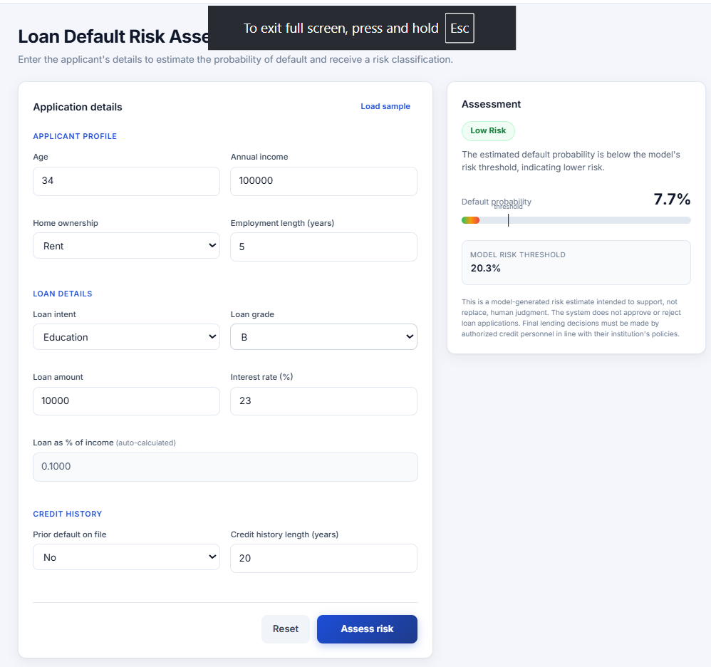
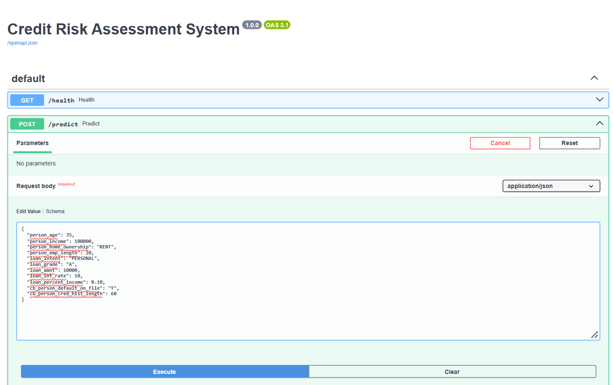
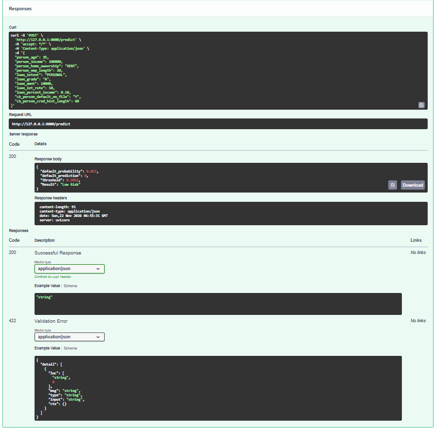

# Credit Risk Assessment System

An end-to-end machine learning application that estimates the probability of loan default and assigns a risk classification using a calibrated XGBoost model.

The project combines data exploration, preprocessing, class-imbalance handling, model comparison, hyperparameter tuning, probability calibration, threshold optimization, model explainability, and a FastAPI-based web application.

> **Note:** This project is an educational/portfolio demonstration. Its predictions are model estimates, not lending decisions or financial advice. A real lending system requires appropriate validation, governance, fairness testing, monitoring, and regulatory review.

## Application Preview

The application accepts applicant and loan details and returns an estimated default probability with a risk classification.

**Credit Risk Assessment Web UI**  


**API Request (`POST /predict`)**  


**API Response (`200 OK`)**  


The application accepts applicant and loan details and returns an estimated default probability with a risk classification.

## Key Features

- Exploratory data analysis and data validation.
- Preprocessing pipelines for numerical and categorical features.
- Logistic Regression baseline and XGBoost model comparison.
- Class-imbalance handling with XGBoost `scale_pos_weight`.
- Hyperparameter search using `RandomizedSearchCV`.
- Isotonic probability calibration.
- Out-of-fold (OOF) classification-threshold selection.
- Global and local model explanations using SHAP.
- False-positive and false-negative analysis.
- FastAPI backend and browser-based frontend.

## Tech Stack

| Area | Tools |
|---|---|
| Language | Python |
| Data analysis | pandas, NumPy |
| Visualization | Matplotlib, Seaborn |
| Machine learning | scikit-learn, XGBoost |
| Explainability | SHAP |
| Model persistence | joblib |
| API | FastAPI |
| Frontend | HTML, CSS, JavaScript |

## Dataset

The notebook reads a file named `credit_risk_dataset.csv`. The target column is `loan_status`:

- `0` — loan repaid / non-default
- `1` — loan default

The notebook contains **32,581 rows initially**. After duplicate removal, **32,416 rows** remain. The final train-test split uses 80% training data and 20% test data, with stratification to preserve the target-class distribution.

The features used are:

**Numerical**
- `person_age`
- `person_income`
- `person_emp_length`
- `loan_amnt`
- `loan_int_rate`
- `loan_percent_income`
- `cb_person_cred_hist_length`

**Categorical**
- `person_home_ownership`
- `loan_intent`
- `loan_grade`
- `cb_person_default_on_file`

The dataset file is not assumed to be included in this repository. Add it only if its licence and redistribution terms permit sharing. Otherwise, document the original dataset source and provide instructions for obtaining it.

## Methodology

### 1. Exploratory Data Analysis and data validation

The notebook examines dataset structure, missing values, target distribution, numerical outliers, summary statistics, and feature correlations.

Data cleaning includes:
- Removing duplicate rows.
- Restricting applicant age to the range 18–100.
- Removing records where employment length is not less than age.
- Removing employment lengths above 60 years.

### 2. Train-test split

The target is separated from the input features. The data is split using:

- Test size: 20%
- Random state: 42
- Stratification: enabled

The test set is held out for final evaluation.

### 3. Preprocessing

Separate `ColumnTransformer` pipelines are used:

- **Logistic Regression:** median imputation and standard scaling for numerical columns; constant imputation and one-hot encoding for categorical columns.
- **XGBoost:** median imputation for numerical columns; constant imputation and one-hot encoding for categorical columns. Numerical scaling is not applied.

The one-hot encoder is configured to ignore previously unseen categories during transformation.

### 4. Class-imbalance handling

The target is imbalanced, with defaulters forming the minority class. To make the model pay greater attention to the minority class, the notebook calculates XGBoost's positive-class weight from the training labels:

`scale_pos_weight = (number of non-defaulters / number of defaulters) × 1.5`

This weighting is used during XGBoost training. Stratified splitting and stratified cross-validation are also used to preserve class proportions.

### 5. Baseline and model selection

A class-weighted Logistic Regression model is trained as a baseline. XGBoost is then trained using a preprocessing pipeline.

XGBoost hyperparameters are searched with `RandomizedSearchCV`:
- 150 parameter combinations sampled.
- 3-fold stratified cross-validation.
- Recall used as the search scoring metric.

The best cross-validation recall reported by the notebook is approximately **0.843**.

### 6. Probability calibration

The selected XGBoost pipeline is calibrated using **isotonic regression** through `CalibratedClassifierCV` with 5-fold cross-validation.

The notebook compares the uncalibrated and calibrated probability calibration curves. Isotonic calibration is retained for the final model.

### 7. Classification-threshold optimization

A default threshold of 0.5 is not necessarily appropriate for an imbalanced credit-risk problem. The notebook generates out-of-fold probabilities on the training data and uses a precision-recall curve to select a threshold.

The selection rule is:

- Minimum precision constraint: **0.74**
- Objective: maximize recall while satisfying that precision constraint.

The selected threshold is approximately **0.2032**. The reported OOF precision and recall at this threshold are approximately **0.74** and **0.81**, respectively.

The selected threshold is then applied to the held-out test probabilities. The threshold is saved separately from the calibrated model.

### 8. Model explainability

SHAP is used to interpret the XGBoost model:

- Global summary plot to inspect overall feature influence.
- Local waterfall plot to explain an individual prediction.

These explanations help inspect how input features contribute to model output. They do not establish causation.

### 9. Error analysis

The final threshold is used to inspect false positives and false negatives on the test set:

- **False positive:** a non-defaulter predicted as a defaulter.
- **False negative:** a defaulter predicted as a non-defaulter.

The notebook reports **370 false positives** and **241 false negatives** at the selected threshold.

In a credit-risk setting, false negatives can expose a lender to default losses, while false positives can incorrectly flag creditworthy applicants. The threshold therefore represents a trade-off rather than a universally optimal decision. The 0.74 precision floor is the project's chosen operating constraint, not a universal industry standard.

## Final Test-Set Results

The following results are from the final notebook's held-out test set of 6,305 records.

### XGBoost with isotonic calibration — default 0.5 threshold

| Metric | Test result |
|---|---:|
| Accuracy | 0.93 |
| Precision (default class, 1) | 0.96 |
| Recall (default class, 1) | 0.73 |
| F1-score (default class, 1) | 0.83 |
| ROC-AUC | 0.95 |

This operating point has high precision, but it misses a larger share of actual defaulters. It illustrates why accuracy and precision alone are not enough for this use case.

### XGBoost with isotonic calibration — optimized threshold

| Metric | Test result |
|---|---:|
| Selected threshold | 0.2032 |
| Accuracy | 0.90 |
| Precision (default class, 1) | 0.75 |
| Recall (default class, 1) | 0.82 |
| F1-score (default class, 1) | 0.79 |
| ROC-AUC | 0.95 |

The lower threshold increases recall for the default class from 0.73 to 0.82, while precision decreases from 0.96 to 0.75. This is the selected operating point because the project prioritizes identifying more potential defaulters while maintaining the chosen minimum-precision constraint.

**Metric note:** ROC-AUC evaluates ranking across thresholds; the precision, recall, F1-score, and accuracy shown above are threshold-dependent. The notebook's final evaluation reports these metrics and the calibration curve. Brier Score and Log Loss are not included in this final reported evaluation.

## Project Structure

The layout below reflects the intended separation between model development, API, and frontend. Adjust filenames if your local project differs.

```text
credit-risk-model/
├── backend/
│   ├── main.py
│   ├── credit_risk_model_final.pkl
│   ├── best_threshold_final.pkl
│   ├── requirements.txt
│   └── runtime.txt
├── frontend/
│   ├── index.html
│   ├── css/
│   │   └── style.css
│   └── js/
│       └── script.js
├── notebooks/
│   └── Credit_Risk_Assessment__Model_Final.ipynb
├── screenshots/
├── .gitignore
├── README.md
└── LICENSE
```

## Run Locally

### Prerequisites

- Python version compatible with the packages in `backend/requirements.txt`.
- Git.
- The trained model and threshold `.pkl` files.

### 1. Clone the repository

```bash
git clone https://github.com/surajgirase2005-data-analyst/<your-repository>.git
cd <your-repository>
```

### 2. Create and activate a virtual environment

**Windows**

```bash
python -m venv .venv
.venv\Scripts\activate
```

**macOS / Linux**

```bash
python -m venv .venv
source .venv/bin/activate
```

### 3. Install backend dependencies

```bash
pip install -r backend/requirements.txt
```

### 4. Start the API

```bash
cd backend
uvicorn main:app --reload
```

Open `http://127.0.0.1:8000` in your browser if the backend serves the frontend at the root route. FastAPI's interactive API documentation is commonly available at `http://127.0.0.1:8000/docs`.

If your frontend is served separately, follow the frontend serving configuration in the repository instead.

## Model Artifacts

The application uses two separately saved artifacts:

- `credit_risk_model_final.pkl` — fitted isotonic-calibrated XGBoost classifier.
- `best_threshold_final.pkl` — optimized classification threshold.

Keep the model and threshold from the same training run together. Do not replace one without updating the other.

Only load pickle/joblib artifacts from trusted sources. These formats can execute code during deserialization.

## Important Considerations and Limitations

- The dataset may not represent every lender, applicant population, or current credit environment.
- The chosen threshold reflects a project-specific precision constraint; real-world thresholds should be selected using validated business costs and policy requirements.
- Class weighting and threshold selection do not eliminate class imbalance or guarantee equal performance across applicant groups.
- SHAP describes model behaviour, not causal relationships.
- Calibration quality can change across populations and over time; it should be monitored on new, representative data.
- The model should support human review, not independently approve or reject loan applications.

## Future Improvements

- Add automated tests for preprocessing, API validation, prediction responses, and threshold behaviour.
- Add data-drift and calibration monitoring.
- Evaluate performance across relevant applicant subgroups and test for unfair outcomes.
- Add model/version metadata and reproducible training configuration.
- Deploy the API and frontend with secure configuration and monitoring.
- Add CI checks and a documented model-retraining workflow.

## Acknowledgements

Built as a machine-learning portfolio project to explore imbalanced classification, probability calibration, threshold selection, model explainability, and API integration.

---

## Author

**Suraj Girase**  
[GitHub](https://github.com/surajgirase2005-data-analyst)
